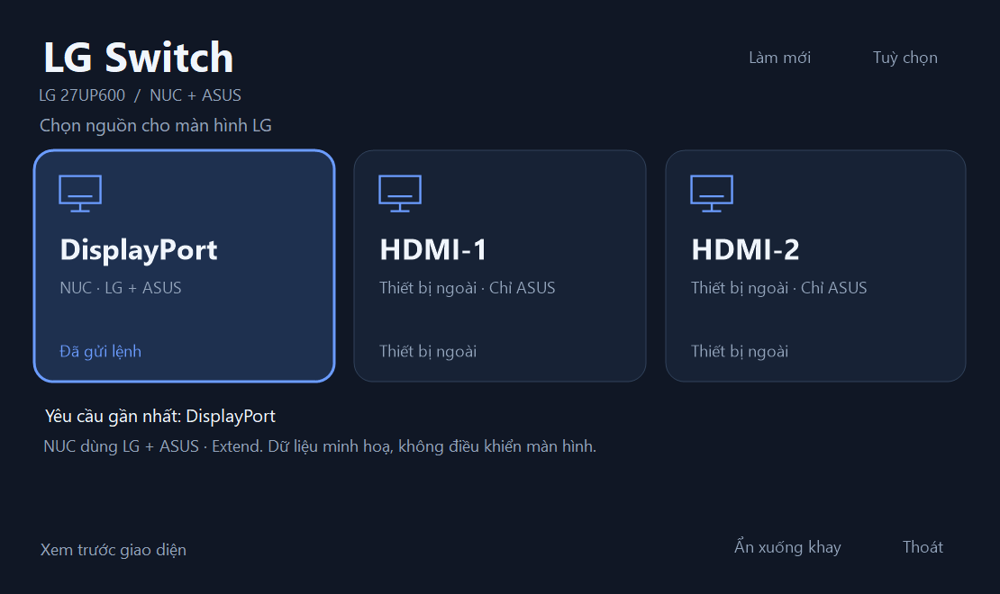

# LG Switch

App Windows portable để chọn nguồn LG 27UP600 và đồng bộ màn hình NUC.



| Nút | LG nhận hình từ | NUC sử dụng |
|---|---|---|
| DisplayPort | NUC | Extend: LG + ASUS |
| HDMI-1 | Thiết bị ở HDMI-1 | Chỉ ASUS |
| HDMI-2 | Thiết bị ở HDMI-2 | Chỉ ASUS |

Người dùng đã xác nhận bản 0.3 chuyển sang HDMI và quay lại DP + Extend thành công trên bộ NUC/LG/ASUS thực tế. Bản 1.0.1 giữ đường điều khiển đó, sửa lỗi vẽ chữ của giao diện tối và yêu cầu quyền admin ngay khi mở.

## Sử dụng

1. Giải nén cả thư mục portable vào nơi có quyền ghi. Lần đầu mở app khi LG đang nhận DP và Windows ở Extend để nhận diện LG + ASUS, lưu layout.
2. Windows yêu cầu quyền quản trị ngay khi mở app. Chấp nhận một lần để bắt đầu phiên; sau đó bấm nguồn muốn dùng. App không hỏi quyền hoặc khởi động lại khi chọn input.
3. Nếu muốn quay về NUC hoặc không thấy hình từ HDMI, bấm **DisplayPort**. Nút này bật Extend trước rồi yêu cầu LG nhận DP.

Không có popup “đã thấy hình chưa”, không có đếm ngược xác nhận. Yêu cầu admin không phải cơ chế bỏ qua UAC: Windows vẫn có thể hỏi quyền ở mỗi lần khởi động phiên app mới.

Click trái tray để mở bảng chọn; click phải có cả ba lệnh input. Đóng cửa sổ ẩn xuống tray, **Thoát** mới kết thúc app. Cửa sổ chọn nguồn được đặt trên ASUS để vẫn thao tác được khi LG dùng thiết bị khác.

## Trạng thái trên giao diện

LG này có thể trả input=0 dù đang hiện hình. Vì vậy:

- **Đang dùng**: input được LG đọc lại hợp lệ.
- **Đã gửi lệnh / Yêu cầu gần nhất**: lựa chọn gần nhất trong app; không khẳng định LG đã đọc xác nhận.
- Chế độ Extend hoặc chỉ ASUS được kiểm tra lại bằng Windows.

Đổi input bằng joystick hoặc từ thiết bị khác có thể làm lựa chọn gần nhất trong app khác input thực tế. Bấm **Làm mới** để đọc lại khi cần.

## Chuyển màn và phục hồi

Chuyển sang HDMI: khôi phục đường điều khiển LG nếu cần, gửi input rồi cho NUC chỉ dùng ASUS. Về DP: bật Extend trước, tạo lại handle LG rồi gửi DP. Các khoảng chờ cho driver/màn hình được giữ nguyên; việc nháy đen khi đổi tín hiệu vẫn có thể xảy ra.

ASUS nằm trong mọi cấu hình mà app áp dụng. DDC chạy trong tiến trình riêng với giới hạn chờ; app giữ kiểm tra đúng monitor, phản hồi GET và khóa I/O. Khi có lỗi API, app thử phục hồi Extend + DP. Watchdog độc lập thử lại sau 90 giây nếu phiên app treo hoặc phục hồi tức thời thất bại.

Nếu firmware nhận lệnh nhưng không đổi input, app có thể không biết điều đó: anh dùng nút DisplayPort để yêu cầu quay lại, hoặc joystick nếu đường điều khiển bị mất. Watchdog không bảo đảm vượt qua lỗi driver/firmware.

## Tuỳ chọn và chẩn đoán

- **LG qua driver Intel**: dùng AUX/I2C, kiểm tra GET độ sáng và đối chiếu Win32 trước một lệnh LG F4. Cần runtime Intel từ driver và quyền quản trị.
- **DDC/CI chuẩn**: VCP0x60. Chỉ dùng nếu monitor thực sự hỗ trợ; bản thử đầu trên UP600 nhận lệnh nhưng không đổi input.
- **Chẩn đoán** ghi nhận diện, capabilities, trạng thái và kiểm tra GET; không SET input, độ sáng hoặc topology.

## Portable Hub

Thêm EXE của bản 1.0.1 vào Hub. Mở từ Hub sẽ yêu cầu quyền Windows rồi hiện bảng chọn, không tự đổi input. Giữ cả thư mục portable cùng nhau.

Cấu hình settings.xml, log và snapshot phục hồi ở cạnh EXE, không phụ thuộc thư mục làm việc của Hub. Có thể chép settings.xml từ 0.3/1.0 sang 1.0.1 khi vẫn dùng đúng máy/cổng; các cờ xác nhận cũ được bỏ qua. Đóng bản cũ trước khi mở bản mới.

## Lưu source trên Git

Tạo repo ngay tại thư mục chứa README này: **outputs/LgSwitch**. Source gồm src/, assets/, project, manifest, config runtime, script build và tài liệu.

.gitignore đã loại release/, settings.xml, recovery/, log, báo cáo chẩn đoán, cache và ZIP. Không cần đưa các file chạy hoặc dữ liệu máy vào commit; có thể đính kèm ZIP portable ở phần Releases nếu muốn.

Thư mục này chưa được khởi tạo Git; chưa có commit hoặc remote.

## Build

Windows 10/11 x64 và .NET Framework4.8; không cần .NET SDK, WebView hay NuGet.

```powershell
powershell -NoProfile -ExecutionPolicy Bypass -File .\build-publish.ps1
```

Kết quả: release/LgSwitch-1.0.1/LgSwitch.exe, có icon nhúng. Xem [BUILD.md](BUILD.md), [VALIDATION.md](VALIDATION.md) và [trạng thái dự án](docs/CURRENT_STATE.md).

Các lệnh --setup, --tray, --diagnose, --self-test, --watchdog-self-test vẫn có. --render-preview chỉ dựng giao diện minh hoạ, không đọc hoặc điều khiển màn hình.
